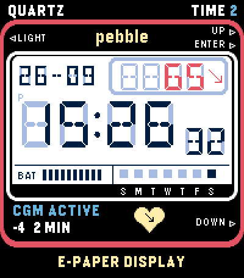
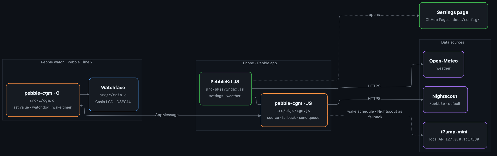

# CasioCGM

[English](README.md) · **Deutsch**

Ein Retro-Watchface im Casio-LCD-Look für die **Pebble Time 2**, mit live **CGM**-Glukosewert aus Nightscout oder iPump-mini.

> Als Diabetiker willst du auch ein cooles Watchface – nicht nur eine nackte Zahl auf dem Display. Deshalb gibt es CasioCGM.

**Status:** im Pebble Appstore · Daten aus Nightscout oder [iPump-mini](https://github.com/sgitaize/iPump-mini) · wird aktiv gepflegt

## So kommst du dran

| | |
|---|---|
| **Pebble Appstore** | [CasioCGM](https://apps.rePebble.com/58fcfcc22c37487f815520db) – über die Pebble-App auf dem Handy installieren |
| **Releases** | [`.pbw` auf GitHub](https://github.com/sgitaize/casiocgm/releases/latest) zum Seitenladen |
| **Einstellungen** | Zahnrad in der Pebble-App → [Einstellungsseite](https://sgitaize.github.io/casiocgm/config/) (Deutsch / Englisch) |



---

## Funktionen

### Anzeige
- **Retro-Design wie die Casio TIME 2** – schwarzes Gehäuse, roter Ring, weißer LCD-Rahmen, gelbes „pebble“ und Banner, Tastenbeschriftungen wie beim Original
- **DSEG14-LCD-Ziffern** – echte Segmentschrift, Geister-Segmente bei allen Ziffern
- **Geister-Segmente** – nicht leuchtende Segmente in einstellbarer Farbe (Standard Lavendel), wie bei einem echten LCD

### Uhrzeit & Datum
- **Große Uhrzeit** – DSEG14 48 px, mittig
- **Sekunden (optional)** – HH:MM in 38 px plus kleine Sekunden unten rechts, wie beim Original
- **Datum** – TT-MM oder MM-TT, links neben der Komplikation und auf gleicher Höhe

### Komplikation (oben rechts)
Sechs wählbare Inhalte – einer dauerhaft, Schütteln wechselt kurz auf einen zweiten:

| Slot | Anzeige |
|---|---|
| 0 – CGM / Blutzucker | 4-stelliger Wert rechtsbündig + Trendpfeil als Grafik |
| 1 – Schritte | Schritte heute (5 Stellen) |
| 2 – Puls | Schläge pro Minute (5 Stellen) |
| 3 – Temperatur | Grad, ohne Einheit (5 Stellen) |
| 4 – Akku % | Prozent, ohne Einheit (5 Stellen) |
| 5 – Zweites Datum | TT-MM oder MM-TT (5 Stellen) |

### Schütteln
- **Schütteln zeigt einen zweiten Wert** – für 5 Sekunden wechselt die Komplikation auf einen zweiten einstellbaren Inhalt
- Praktisch für einen schnellen Blick auf Delta, Schritte usw., während der Hauptinhalt Standard bleibt; auch das Datumsfeld kann beim Schütteln einen Wert zeigen

### Infoleiste
- **Akkuanzeige** – BAT mit 10 Segmenten
- **Wochentage** – 7 Kästchen (heute gefüllt) mit S M T W T F S oder deutsch S M D M D F S

### CGM
- **Zwei Datenquellen:** Nightscout (`/pebble`, Standard) oder [iPump-mini](https://github.com/sgitaize/iPump-mini) – die iPhone-App, die eine MiniMed 780G direkt ausliest, ganz ohne Internet. Mit iPump-mini kann Nightscout als Ersatz einspringen (erkennbar an einer kleinen Wolke).
- **Akkuschonender Abgleich:** Abruf direkt nach jedem neuen Sensorwert statt Dauerabfrage; mit iPump-mini im Weckrhythmus der App, und die Uhr stößt das Handy an, wenn es still bleibt.
- Zeigt Wert, Trendpfeil (9 Varianten), Delta und Alter; der letzte Wert bleibt nach einem Neustart des Watchfaces erhalten.
- Erkennt veraltete Werte, färbt nach Bereich (im Ziel / hoch / niedrig), auf Wunsch Vibration bei niedrig oder hoch.
- Status unter dem LCD: **CGM Active** / **Old BG** / **No Conn** / **OPEN APP** (iPump-mini läuft nicht) / **No URL**.
- Gemeinsame CGM-Logik: [pebble-cgm](https://github.com/sgitaize/pebble-cgm), genutzt auch von [Nightscout-supercgm](https://github.com/sgitaize/Nightscout-supercgm) und [91 Dub CGM](https://github.com/sgitaize/dubv4cgm).

### Beschriftungen & Banner
- **Oberes Banner** (über dem roten Band) – zwei freie Texte (Standard: links `CGM`, rechts `TIME 2`), Farbe einstellbar
- **„pebble“ in der Mitte** – Gothic Bold, standardmäßig gelb, passend zum E-Paper-Banner
- **Tastenbeschriftungen** – ◄LIGHT, UP►, SELECT►, DOWN► rund um den LCD-Rahmen
- **Unteres E-Paper-Banner** – `E-PAPER DISPLAY` in Gelb auf Farbmodellen; darüber ein einstellbarer Text

### Farben frei wählbar (Pebble Time / Time 2)
Alle Farben über die Einstellungsseite:

| Farbe | Standard | Wofür |
|---|---|---|
| Hintergrund | `#EEEEEE` | LCD-Fläche |
| Vordergrund | `#000044` | Ziffern, Rahmen, Beschriftungen |
| Akzent | `#FFAA00` | (reserviert) |
| CGM im Ziel | `#38571A` | Wert im Zielbereich |
| CGM hoch | `#FFAA00` | Wert über der Obergrenze |
| CGM niedrig | `#AA0000` | Wert unter der Untergrenze und offline |
| Geister-Segmente | `#ADADAD` | nicht leuchtende Segmente |
| Banner oben | `#FFFFFF` | Farbe von CGM / TIME 2 |

### Plattform
Nur für die **Pebble Time 2** (emery, 200×228 px) – DSEG14-Bold-Schriften, Uhrzeit über die volle Breite, 22-px-Komplikation.

---

## Architektur

<p align="center"></p>

<sub>Quelle: <a href="docs/architecture.mmd">docs/architecture.mmd</a> (Mermaid)</sub>

**So funktioniert es**
- **Die Uhr zeichnet, das Handy holt die Daten.** Der C-Code auf der Uhr zeichnet das Watchface und merkt sich den letzten Wert; das JavaScript in der Pebble-App (PebbleKit JS) spricht mit dem Internet und schickt kompakte AppMessages.
- **pebble-cgm** übernimmt alles rund um CGM auf beiden Seiten: Quelle wählen, Abruf passend nach jedem neuen Wert, Weckplan von iPump-mini, Ersatz durch Nightscout, Sendewarteschlange mit Bestätigung und ein Wächter auf der Uhr.
- **Die Einstellungen** sind eine statische Seite auf GitHub Pages; die Konfiguration reist im URL-Fragment, dein Nightscout-Token erreicht also nie einen Server.
- Schritte und Puls kommen direkt von der Uhr (HealthService), das Wetter von Open-Meteo.

| Baustein | Ort | Aufgabe |
|---|---|---|
| Watchface | `src/c/main.c` | Zeichnen, Layout, Komplikationen, Schütteln, Speichern |
| CGM (Uhr) | `src/c/cgm.c` | letzter Wert, Status, Wächter, Weck-Timer (aus pebble-cgm) |
| Handy-Skript | `src/pkjs/index.js` | Einstellungen, Wetter, Akku, Nachrichten an die Uhr |
| CGM (Handy) | `src/pkjs/cgm.js` | Nightscout / iPump-mini, Zeitplan, Ersatzquelle (aus pebble-cgm) |
| Einstellungsseite | `docs/config/` | Deutsch / Englisch, Live-Vorschau |
| Store-Eintrag | `store/` | Beschreibung, Screenshots, `publish.sh` |
| Entwickler-Notizen | [`agents.md`](agents.md) | Nachrichten-Schlüssel, Layout, Status-Logik |

## Einstellungen

Das Zahnrad in der Pebble-App öffnet die Einstellungsseite, auf **Deutsch und Englisch** (Umschalter oben rechts).

### Datenquelle / CGM
| Einstellung | Standard | Beschreibung |
|---|---|---|
| Datenquelle | Nightscout | Nightscout oder iPump-mini (lokale App auf dem iPhone) |
| iPump-mini-Ersatz | aus | Nightscout nutzen, wenn iPump-mini nicht erreichbar ist (Wolken-Symbol) |
| Nightscout-URL | – | vollständige Adresse, z. B. `https://mysite.ns.10be.de` – `/pebble` wird angehängt |
| API-Token | – | nur nötig, wenn deine Seite eine Anmeldung verlangt |
| Einheit | mg/dL | mg/dL oder mmol/L |
| Obergrenze | 180 | darüber in der Farbe „CGM hoch“ |
| Untergrenze | 70 | darunter in der Farbe „CGM niedrig“ |
| Veraltet nach | 10 min | ab wann ein Wert als alt gilt |

### Komplikation
| Einstellung | Standard | Beschreibung |
|---|---|---|
| Hauptinhalt | CGM | dauerhaft in der Komplikation |
| Schütteln – zweiter Inhalt | CGM-Delta | für 5 s beim Schütteln |

### Datum & Uhrzeit
| Einstellung | Standard | Beschreibung |
|---|---|---|
| Datumsformat | TT-MM | TT-MM oder MM-TT |
| Erster Wochentag | Sonntag | Sonntag oder Montag |
| Sprache der Wochentage | Englisch | Englisch (S M T W T F S) oder Deutsch (S M D M D F S) |
| Sekunden | aus | kleine Sekunden neben HH:MM |

### Beschriftungen
| Einstellung | Standard | Beschreibung |
|---|---|---|
| Oben links | `CGM` | linker Text im oberen Streifen |
| Oben rechts | `TIME 2` | rechter Text im oberen Streifen |
| Unteres Banner | `CGM Enabled` | Text im E-Paper-Streifen |

### Farben
| Einstellung | Standard | Beschreibung |
|---|---|---|
| Hintergrund | `#EEEEEE` | LCD-Fläche |
| Vordergrund | `#000044` | Ziffern, Rahmen |
| Akzent | `#FFAA00` | (reserviert) |
| CGM im Ziel | `#38571A` | Wert im Zielbereich |
| CGM hoch | `#FFAA00` | Wert ab der Obergrenze |
| CGM niedrig | `#AA0000` | Wert ab der Untergrenze oder veraltet |
| Geister-Segmente | `#ADADAD` | heller = dezenter |
| Banner oben | `#FFFFFF` | Farbe von CGM / TIME 2 |

---

## Selbst bauen

```bash
# Pebble SDK 4.33.1 (pebble-tool 5), Ziel emery
pebble build
# Ergebnis: build/*.pbw
```

Sauber neu bauen:
```bash
pebble clean && pebble build
```

---

## Status & Pläne

- **Live:** 2.5.1 im Pebble Appstore (Nightscout und iPump-mini, Stabilitäts-Fixes aus pebble-cgm 1.1.0).
- Ideen und Fehler gerne als [Issue](https://github.com/sgitaize/casiocgm/issues).

---

## Unterstützen

Wenn dir CasioCGM gefällt, freue ich mich über eine kleine Spende:

[](https://paypal.me/simongutjahr)

---

## Motivation & Dank

- **Warum:** Als Diabetiker willst du auch ein cooles Watchface. CasioCGM verbindet Retro-Casio-Optik mit live CGM-Daten.
- **Design angelehnt an** [*Quartz by Dalpek*](https://apps.repebble.com/quartz-by-dalpek_31cfe29ecd814df4b5ca8bb4) – danke für das tolle Retro-LCD-Design! (Kein Code übernommen; das Watchface ist neu geschrieben, das Design aber eng an Quartz angelehnt.)
- **CGM-Logik** ursprünglich aus [Nightscout-supercgm](https://github.com/sgitaize/Nightscout-supercgm), heute gemeinsam in [pebble-cgm](https://github.com/sgitaize/pebble-cgm).
- **Zu ~95 % mit KI gebaut** – mit [Claude Code](https://claude.com/claude-code).

---

## Lizenz

MIT – mach damit, was du willst, eine Namensnennung freut mich.
